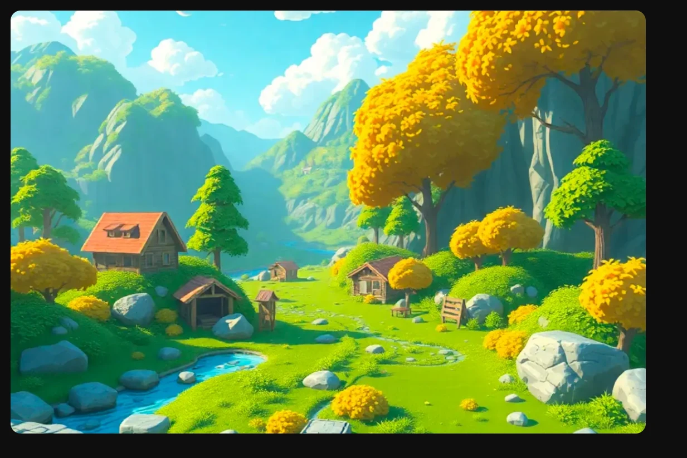

# 09 — Tema ve Model Kuralları

Bu dosya oyunun görsel dilini, arayüzün font/renk kurallarını ve her 3B modelin uyması gereken teknik kuralları tanımlar. Model, harita ya da UI yapan herkes (insan ya da yapay zekâ aracı) işe başlamadan önce bunu ve [01-oyun-tasarimi.md](01-oyun-tasarimi.md) dosyasını okur. İkisi çelişirse `01` (hikâye) kazanır; `CLAUDE.md` ikisinin de üstündedir.

> **Kaynak:** Kurallar ekibin önceki Simya reposundaki `md/01` ve `md/02` belgelerinden **metin olarak** uyarlandı. Jam'in "0'dan üret" kuralı gereği oradaki modeller, Blender scriptleri (`harita3`), shader ve Unity araçları bu projeye **kopyalanmaz**; gerekenler burada yeniden yapılır.

## 1. Referans

Hedef bu görselin **rengi, ışığı ve form dili**. Görsel bir kopyalama kaynağı değil, yön göstericidir: içindeki evleri ya da ağaçları birebir modellemiyoruz, aynı dünyaya aitmiş gibi duran kendi modellerimizi yapıyoruz. Görselin kaynağı belli değil; **oyunun içinde ya da tanıtımında kullanılmaz.**

Bilgi Adası'ndaki karşılığı: Kimya şehri bu vadide kurulu, ortaçağ havasında küçük bir simyacı kasabasıdır. Atölye, köyler ve aradaki sokak/meydan bu görsel dille yapılır.

## 2. Kesin kurallar (tartışılmaz)

1. **"Yapay zekâ fontu" yok.** Her AI çıktısında görülen jenerik, varsayılan fontlar oyunda başlık ya da gövde metni olamaz (ör. Inter, Roboto, Poppins, Montserrat, Open Sans, Arial/Liberation Sans, Segoe UI). Klişe "fantastik" fontlar da yok (Papyrus, Comic Sans, aşırı süslü gotik yazılar). Font, temaya göre **araştırılarak** seçilir: ortaçağ el yazması/atölye hissi veren ama projektörde okunan bir başlık fontu + sade, okunaklı bir gövde fontu. Şartlar: SIL OFL ya da eşdeğeri açık lisans, **ğ ş ı İ ç ö ü** ve `→` desteği, 28 px'te okunur. Seçilen fontlar §8'e ve `05_Uretim/LICENSES.md`'ye yazılır.
2. **"Yapay zekâ rengi" yok.** Mor-pembe gradyan, neon, cam efekti (glassmorphism), rastgele doygun renk, "teknoloji mavisi" yok. **Her renk §3'teki paletten** ya da ondan türetilmiş (aynı tonun açığı/koyusu) olmalıdır. Paletin dışına çıkmak gerekiyorsa önce burada tabloya eklenir, sonra kullanılır. UI da bu kurala dahildir.
3. **Göze güzel hitap eden, basite kaçmayan tasarım.** Ham primitif, kalıp model, üzerinde çalışılmamış düz kutu UI yok (bkz. §5). Her model ve ekran "bu oyun için özel yapılmış" görünmelidir.
4. **Önce referans, sonra üretim.** Hiçbir model, ekran ya da harita parçası referans araştırması yapılmadan başlamaz (bkz. §6). Blender MCP kullanılırken bu adım atlanmaz.

## 3. Görsel dil

### Ne görüyoruz

- **Güneşli, canlı bir vadi.** Öğle ışığı, açık gökyüzü, tok ve temiz renkler. Kasvet, gece yok.
- **İki renk karşıtlığı:** soğuk taraf (gökyüzü, su, uzak dağlar) ile sıcak taraf (altın sarısı yapraklar, turuncu çatılar). Yeşil ikisini bağlar.
- **Yuvarlak, tombul kütleler.** Ağaç tepeleri yaprak yığınlarından oluşan bulutlar gibi; çalılar ve tepeler yumuşak kubbeler.
- **Düz yüzeyli iri kayalar.** Az sayıda büyük yüzey, keskin ama yumuşatılmış kırıklar.
- **Küçük, sıcak yapılar.** Gövdeye göre büyük çatı, kalın kirişler, hafif eğrilik. Hiçbir şey cetvelle çizilmiş gibi durmaz.
- **Derinlik renkle ve pusla verilir.** Uzaklaştıkça her şey maviye ve açığa kayar.
- **Kilitli bölgeler** (kilitli köy/ilçe/şehirler) gri, kasvetli bir sisle değil, gökyüzü tonlarında **açık mavi bir pusla** kapanır. Kilitli olduğu anlaşılır ama sahne yine aydınlık kalır.

### Renk paleti

Değerler referanstan gözle alınmış başlangıç değerleridir; ilk sahne kurulduktan sonra Unity'de ışık altında kontrol edilip burada güncellenir.

| Grup | Aydınlık | Orta | Gölge |
|---|---|---|---|
| Çimen | `#A6E03C` | `#6CC02E` | `#2F8A3A` |
| Yeşil yaprak | `#7ED63B` | `#3FA83A` | `#1F6E3A` |
| Altın yaprak (vurgu) | `#FFD23F` | `#F7A800` | `#D07A00` |
| Gökyüzü | `#BDEFFA` | `#4FCBEA` | `#2A9FD0` |
| Su | `#C8F6FF` | `#35BDEB` | `#1E86C4` |
| Uzak dağ / uçurum | `#9AD3D6` | `#6FA9B8` | `#4F7F96` |
| Kaya | `#D5DEE6` | `#A3B1BE` | `#6E8090` |
| Çatı (vurgu) | `#FF7A3D` | `#E8602A` | `#B5431C` |
| Ahşap | `#B07A4E` | `#8A5A3A` | `#5C3A26` |
| Sıva (iç duvar, dolgu) — türetilmiş | `#DDDCC5` | `#A7A09B` | `#686B70` |

| Bakır (kazan, imbik, su banyosu) — türetilmiş | `#D77A45` | `#9F4E2B` | `#773D23` |

| Kil (pişmiş toprak: athanor, küp, kroze) — türetilmiş | `#CBB595` | `#987D6A` | `#62524B` |

*Kil satırı türetilmedir:* aydınlık = sıva aydınlık %60 + ahşap aydınlık %40; orta = sıva orta %50 + ahşap orta %50; gölge = sıva gölge %50 + ahşap gölge %50 (13.11).

*Bakır satırı türetilmedir:* aydınlık = çatı aydınlık %50 + ahşap aydınlık %50; orta = çatı gölge %50 + ahşap orta %50; gölge = çatı gölge %30 + ahşap gölge %70 (13.11).

*Sıva satırı türetilmedir:* aydınlık = kaya aydınlık %80 + altın aydınlık %20; orta = kaya orta %70 + ahşap aydınlık %30; gölge = kaya gölge %70 + ahşap gölge %30. İç mekânın sıcak kalması için eklendi (13.11).

Oranlar: sahnenin yaklaşık **%60'ı yeşil**, **%25'i mavi**, **%15'i sarı-turuncu vurgu**. Vurgu rengi her yere yayılmaz; oyuncunun bakmasını istediğimiz yerde toplanır (aktif istasyon, görev veren sakin, sıradaki köy).

**Yasak renkler:** saf siyah, saf beyaz, gri-kahverengi "çamur" tonları, neon mor-pembe. Gölgeler siyaha değil maviye ya da koyu yeşile kayar.

**UI rengi:** UI paleti bu tablodan türetilir (ahşap, kâğıt, mürekkep, altın vurgu). Kâğıt ve mürekkep tonları henüz seçilmedi (§9); seçilince bu tabloya satır olarak eklenir. Metin rengi saf siyah değil, ahşabın en koyu tonuna yakın bir mürekkep rengidir.

### Işık

- Tek ana ışık: sıcak beyaz güneş, yukarıdan ve yandan.
- Gölgeler yumuşak ve hafif mavi.
- Ortam ışığı gökyüzünden gelir; karanlıkta kalan yüz bile renklidir.
- Atölye içi de aynı dünyaya aittir: pencereden giren gün ışığı ana kaynaktır, kazan ateşi ve mum ikinci plandadır.

### Form kuralları

- Siluet önce gelir. Model tek renge boyandığında ne olduğu anlaşılmalı.
- Oranlar abartılır: kalın ayaklar, iri çatılar, tombul şişeler. Gerçek ölçü değil, okunabilirlik.
- Hiçbir kopya birebir aynı durmaz. Tekrarlanan parçalar (tahta, taş, yaprak kümesi) boyut, açı ve tonda hafifçe oynar.
- Detay yüzeyde değil kütlede aranır: desen, gürültü dokusu ya da çizik yerine bir pah, bir eğim, bir çıkıntı.
- **Gölgeleme yumuşaktır, kırık yüzlü (faceted) değil.** Az poligonlu ama kristal gibi parçalı görünmez:
  - Ağaç tepeleri ve çalılar kabarık kümelerden oluşur; normalleri kümenin ve tepenin merkezinden yumuşatılır (özel normal).
  - Yapı ve eşyalarda kenarlara küçük pah atılır; düz yüzler keskin, pahlar yumuşak gölgelenir (açıya göre keskin kenar, ~35°).
  - Çimen, çiçek ve yaprak gibi ince parçaların normali yukarı bakar; zeminle aynı ışığı alır.
- **Renk köşe rengiyle (vertex color) verilir.** Her parça kendi içinde alttan üste koyudan açığa geçer; zemin büyük lekelerle renk değiştirir. Fotoğraf dokusu, gürültü dokusu, PBR detay haritası yok.
- Zemin boş kalmaz: göz hizasında çimen öbekleri, çiçek tarhları, çakıl ve kayalar görünür.

## 4. Arayüz (UI) görsel kuralları

`08-mustafa-entegrasyon.md` §4'teki teknik kurallara (Canvas Scaler 1920×1080, en az 28 px, TMP alt indis) ek olarak:

- UI dünyanın bir parçası gibi durur: kâğıt, ahşap çerçeve, mühür, mürekkep, ustanın defteri. Düz renkli yuvarlak köşeli "uygulama kartı" görünümü yok.
- Renkler §3'ten; vurgu (altın/turuncu) yalnızca oyuncunun bakması gereken yerde (dengede olan terazi, aktif düğme, ipucu parlaması).
- İkonlar elle çizilir ya da basit vektörle kurulur; hazır ikon seti kullanılırsa lisansı yazılır ve tek bir set içinde kalınır.
- Formüller her yerde alt indisle: H₂O (TMP: `H2O`).
- Her ekran projektörde, 3 m uzaktan okunur mu diye denenir.

## 5. "Yapay zekâ işi" görünümüne karşı kurallar

Aşağıdakilerden biri varsa model ya da ekran kabul edilmez:

1. **Hazır üretilmiş mesh.** Metinden ya da görselden 3B üreten araçların çıktısı (Blender MCP `generate_3d` dahil) nihai model olarak kullanılmaz. Fikir almak için bakılabilir; model elle ya da elle yazılmış, okunabilir bir script ile kurulur.
2. **Kalıp model.** Her oyunda görülen fıçı, sandık, iksir şişesi olduğu gibi konmaz. Aynı nesne bu dünyaya göre yeniden tasarlanır: oranı, silueti ya da bir ayrıntısı bize ait olmalı.
3. **Sebepsiz nesne.** Her modelin hikâyede ya da görevde bir karşılığı vardır. "Boş durmasın" diye eklenen dolgu nesnesi olmaz.
4. **Kusursuz simetri ve tekrar.** Kopyala-yapıştır dizilmiş, hepsi aynı açıda duran nesneler.
5. **Rastgele detay.** Anlamı olmayan çıkıntılar, gelişigüzel serpilmiş parçalar, yüzeye gürültüyle verilmiş "zenginlik".
6. **Ham primitif.** Üzerinde çalışılmamış küp, silindir ya da küre.
7. **Dağınık topoloji.** İç içe geçmiş, havada duran, birbirinin içinden geçen parçalar.
8. **Tutarsız stil.** Paletin dışında renk, jenerik font, sahnenin geri kalanından farklı detay yoğunluğu.

Kontrol sorusu: *Bu modeli bir çevre sanatçısının portfolyosunda görsem, bu oyun için özel yapıldığını anlar mıyım?*

## 6. Çalışma akışı: referans → blokaj → model → kontrol

Bu akış insan için de Blender MCP ile çalışan Claude için de aynıdır. **Basite kaçmak için adım atlanmaz.**

1. **Referans araştırması (zorunlu, bol).** Her model, harita parçası ya da ekran için en az **6–8 referans** toplanır:
   - Aynı stilde stilize low-poly oyunlardan ve çevre sanatçısı portfolyolarından örnekler (form ve renk için),
   - Gerçek dünyadan örnekler (ortaçağ atölyesi, taş köprü, çeşme, kazan, terazi… — oran ve yapı mantığı için),
   - Bu dosyadaki tema referansı (renk ve ışık için).
   Referansların **bağlantıları** ve her birinden ne alındığı (siluet, oran, renk, detay) `ArtSource/Referans/<ad>.md` dosyasına yazılır. Lisansı belirsiz görseller repoya konmaz.
2. **Siluet ve blokaj.** Önce kaba kütleler; göz hizasından (1,56–1,68 m) ve istasyon kamerasından bakılır. Tek renkle siluet okunuyor mu?
3. **Model.** Blender'da elle ya da okunabilir Python scriptiyle kurulur. Script `ArtSource/Blender/Script/` altında saklanır (yeniden üretilebilirlik + "0'dan üret" kanıtı). Pah, yumuşak normal, köşe rengi bu adımda.
4. **Kontrol.** Birden fazla açıdan ve mesafeden görüntü alınır (Blender MCP'de `look`), referansla yan yana karşılaştırılır, §5 listesi ve §8 kontrol listesi işaretlenir. Zayıf görünen yer düzeltilmeden bir sonraki modele geçilmez.
5. **Unity'de ışık altında son bakış.**

Blender MCP notları:
- `search_assets` / `import_asset` (Poly Haven, Sketchfab, Poly Pizza) ve `generate_3d` yalnızca **fikir/ölçek denemesi** içindir; nihai sahneye girmez (§5 madde 1, lisans ve "0'dan üret" kuralı).
- Malzeme rengi shader node girişine verilir (`material.diffuse_color` yalnızca görünümü etkiler); düğümler türüne göre bulunur, adına göre değil.

## 7. Teknik kurallar

### Poligon bütçesi

Sayılar üçgen (tri) cinsindendir ve başlangıç değeridir; sahne ağırlaşırsa düşürülür. En yakın (LOD0) sürüm için; uzak sürümler (LOD1/LOD2) Blender'da sadeleştirilir.

| Tür | Üst sınır |
|---|---|
| Küçük eşya (şişe, mum, kitap, kavanoz) — yalnız dekor | 150 |
| **Taşınabilir eşya** (envantere girer, elde 3B görünür: malzeme kapları, el aletleri; yakın plan, 16+ kenar) | 1.200 |
| Orta eşya (tabure, fıçı, sandık) | 600 |
| Büyük eşya (tezgâh, kazan, terazi) | 1.500 |
| Araç (bisiklet; oyuncu biner, gidon/sepet FPS'te yakın plan) | 4.800 |
| Kaya | 600 |
| Ağaç | 1.300 |
| Çimen öbeği / çiçek | 80 / 120 |
| Küçük yapı (kulübe, kuyu, çeşme) | 6.000 |
| Ana yapı (atölye, ev) | 32.000 |
| Kamera görüşündeki toplam (PC) | 250.000 |

- Görünmeyen yüz bırakılmaz: zemine, duvara ya da başka sabit bir parçaya dayanan yüzler silinir. "Görünmeyen" oyuncunun yürüyebildiği her noktadan bakılarak belirlenir.
- Optimizasyon modeli küçültmekle değil düzenle sağlanır (bkz. "Unity'de çizim düzeni").
- Silueti değiştirmeyen kenar eklenmez. Yuvarlak kesitlerde 6–10 kenar yeter.
- Her kenara pah atılmaz; yalnızca siluette ya da ışığı yakalayan yerde.
- Yazı mesh olarak modellenmez (etiket, tabela, tahta yazısı). TMP ya da doku ile verilir.

### Ölçek ve yürünebilirlik

Ölçüler `08-mustafa-entegrasyon.md` §1 ile aynıdır: 1 birim = 1 m, göz 1,56 → 1,68 m (oyuncu büyür), kapı ≥ 2,1 m, tezgâh ~0,9 m, raf üstü ≤ 1,8 m, eşik ≤ 0,3 m, rampa ≤ 45°.

- Modeller yakından ve göz hizasından görülür: açık kalan kenar, içi görünen kütle, havada duran parça olmaz.
- Oyuncunun gidemeyeceği yerler kayalık, dere, çit gibi doğal sınırlarla ya da kilitli bölge pusuyla kapatılır; görünmez duvar son çaredir.
- Çarpışma için basit hacimler (kutu, kapsül) ya da sadeleşmiş (LOD1) mesh; ayrıntılı çarpışma yalnızca zeminde.

### Pivot ve parça yapısı

- **Hareket eden her parça tek mesh'tir** ve pivotu hareket ettiği eksendedir:
  - Kapı, dolap kapağı: menteşe kenarı, tabanda.
  - Sandık kapağı: arka menteşe çizgisi.
  - Dönen nesne (kazan, çark): dönme ekseni, tabanda.
  - Asılı nesne (tabela, ot demeti): asıldığı nokta.
- **Taşınabilen eşya** (kavanoz): pivot taban ortasında, nesne dik durur.
- **Sabit parçalar** mantıklı gruplar halinde birleştirilir (bir duvar, bir mobilya). Sahneyi tek mesh yapmak da, her tahtayı ayrı obje bırakmak da yanlıştır.
- Dışa aktarmadan önce ölçek 1, dönüş 0 uygulanır (hareketli parçanın kasıtlı dönüşü hariç).
- **Hiyerarşi en fazla bir kademe:** üst obje ve doğrudan çocukları. Daha derin hiyerarşi Blender'ın FBX dışa aktarımında alt parçaları yanlış yere koyabiliyor.
- İstasyon modelleri `Station_*` prefab'ının `Visual` objesinin altına konur; kök bileşene ve `CameraPoint`'e dokunulmaz (`08` §2).

### Adlandırma

- Sabit mesh: `SM_` öneki (`SM_Duvar_Kuzey`, `SM_Tezgah`). Unity'de Static işaretlenir.
- Hareketli ya da etkileşimli parça: önek yok, ne olduğu yazılır (`Kapi_Kanat`, `Terazi_Sol_Kol`).
- Türkçe, ASCII harflerle, kelimeler alt çizgiyle ayrılır. `Cube.001` gibi varsayılan ad kalmaz.
- Kodun bağlandığı adlar (`Station_*`, `CameraPoint`, `Visual`, `Neighborhood_*`, `Before`/`After`/`Part_1…5`, `PlayerSpawn`) `08` §2'dekidir; değiştirmeden önce Mehmet'e haber verilir.

### Malzeme ve doku

- Her şey **tek malzeme** kullanır: Blender'da `M_Stilize`, Unity'de köşe rengini okuyan URP shader (`BilgiAdasi/Stilize`, bu projede yeniden yazılacak). Renk köşe renginden gelir; doku yoktur.
- Ayrı malzeme yalnızca şunlar için açılır: su (`M_Su`), kendi ışığı olanlar (`M_Fener`, `M_Kopuk`, `M_Duman`, `M_Bulut`; aynı shader, ışıma değeriyle).
- **`M_Cam` (saydam cam) yalnız damıtma düzeneğinin toplama şişesinde (kâbile)** kullanılır: damıtılan sıvının birikmesi görülmezse damıtma öğretilemez (13.11). Diğer bütün camlar opak pastel kalır.
- Malzeme adları Blender ile Unity arasında birebir aynıdır.

### Dışa aktarma (Blender → Unity)

- Biçim FBX; birim metre; ileri `-Z`, yukarı `Y`; eksen dönüşümü gömülü (`bake_space_transform`). Unity'de "Bake Axis Conversion" kapalı.
- Normaller olduğu gibi aktarılır (`Smoothing: Normals Only`), Unity'de "Normals: Import". Köşe renkleri lineer (`colors_type=LINEAR`).
- LOD adlandırması: `Ad` (boş üst obje) + `Ad_LOD0`, `Ad_LOD1` (, `Ad_LOD2`).
- Gizli koleksiyondaki objelerin dünya konumu dışa aktarımda hesaplanmayabilir; "önce/sonra" parçaları dışa aktarmadan önce görünür koleksiyonda kontrol edilir.
- Dışa aktarım mümkün olduğunca scriptle yapılır (aynı ayar her seferinde).

### Unity'de çizim düzeni (optimizasyon)

- **Kadraj dışı ayıklama** Unity'de otomatiktir; bakış yönüne göre yükleme/boşaltma yapılmaz (dönüşlerde takılma yapar).
- **LOD:** her parça uzaklaştıkça sadeleşir, çok uzakta hiç çizilmez (ağaç: LOD0 → LOD1 %35 → LOD2 %12 → yok).
- **Kopyalar:** ağaç, çalı ve kayalar prefab'dır; aynı modelin kopyaları GPU instancing ile toplu çizilir.
- **Uzak manzara** (dağlar, arka kayalıklar) tek mesh'tir ve gölge düşürmez.
- **Occlusion culling:** binalar ve kayalıkların arkasında kalanlar çizilmez.
- **Kalite (PC) hedefi:** MSAA 4x, yumuşak gölgeler, HDR, son işlemede Neutral tonlama + hafif bloom. Bunlar `ProjectSettings/` ve `Assets/Settings/` içindedir: **değiştirmeden önce Mehmet'e haber verilir.**
- **Düzenleyicide bakarken:** Game penceresinde "Low Resolution Aspect Ratios" kapalı ve Scale 1x olmalı. Windows ölçeklemesi %150 iken bu seçenek açıksa oyun 2/3 çözünürlükte çizilip büyütülür ve bulanık görünür (build'i etkilemez).

### Klasörler

| Yer | Sahibi | İçerik |
|---|---|---|
| `Assets/_Project/Art/` | Mustafa | Models, Materials, Shaders |
| `Assets/_Project/Level/` | Mustafa | Level prefabları, ortam parçaları, ışık ayarları |
| `Assets/_Project/UI/` | Mustafa | UI prefabları, view'lar için görseller, fontlar, ikonlar |
| `ArtSource/` (repo kökü, Assets dışı) | Mustafa | `.blend` dosyaları, Blender scriptleri, referans listeleri |
| `Assets/_Project/Scripts/`, `Data/` | Mehmet | Dokunulmaz (`08` §5) |

## 8. Teslim kontrol listesi

Bir model ya da ekran sahneye girmeden önce:

- [ ] Referans listesi `ArtSource/Referans/` içinde (en az 6–8 kaynak).
- [ ] Hikâyede/görevde karşılığı var.
- [ ] Tek renge boyandığında silueti okunuyor.
- [ ] Renkleri paletten; font onaylı listeden.
- [ ] Üçgen sayısı bütçenin altında, görünmeyen yüz yok.
- [ ] Hareketli parçalar ayrı, tek mesh ve pivotları doğru.
- [ ] Adlandırma kurala uygun.
- [ ] Tek malzeme (`M_Stilize`); ek malzemenin gerekçesi var.
- [ ] Uzak sürümleri (LOD) var; yakından ve uzaktan bakıldı.
- [ ] Unity'de içe aktarılıp ışık altında bakıldı.
- [ ] Hazır bir şey kullanıldıysa `05_Uretim/LICENSES.md`'de satırı var.

**Onaylı fontlar:** (henüz seçilmedi — §9)

## 9. Açık konular

- `BilgiAdasi/Stilize` URP shader'ı (köşe rengi + yumuşak gölge) bu projede yazılmadı; ilk model içe aktarılmadan önce gerekli.
- Başlık ve gövde fontu seçilmedi. Şu an projede yalnızca Liberation Sans (TMP varsayılanı) var; §2 madde 1 gereği oyuncuya görünen metinde kullanılmayacak.
- UI paleti (kâğıt, mürekkep, çerçeve tonları) seçilmedi.
- Kalite ayarları (MSAA, gölge, son işleme) `ProjectSettings`'te; Mehmet'le birlikte ayarlanacak.
- Poligon bütçeleri ilk sahne kurulduktan sonra ölçülüp gözden geçirilecek.
